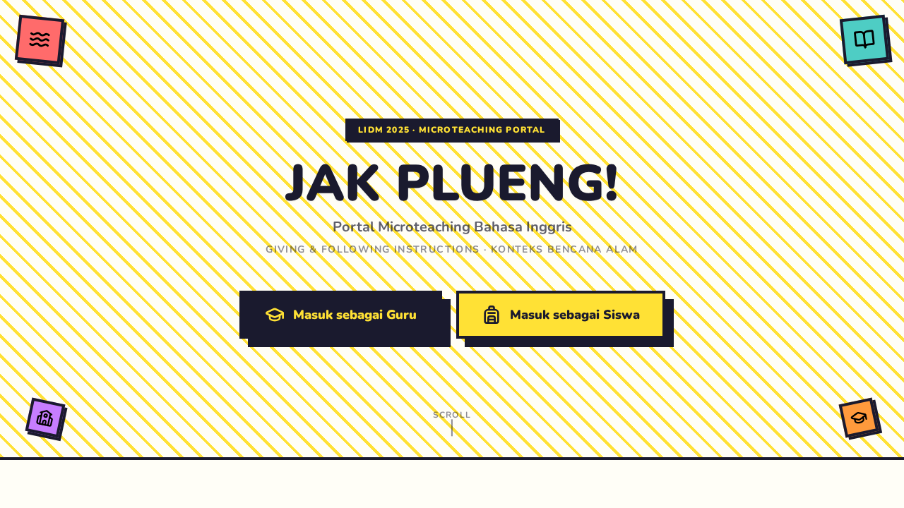
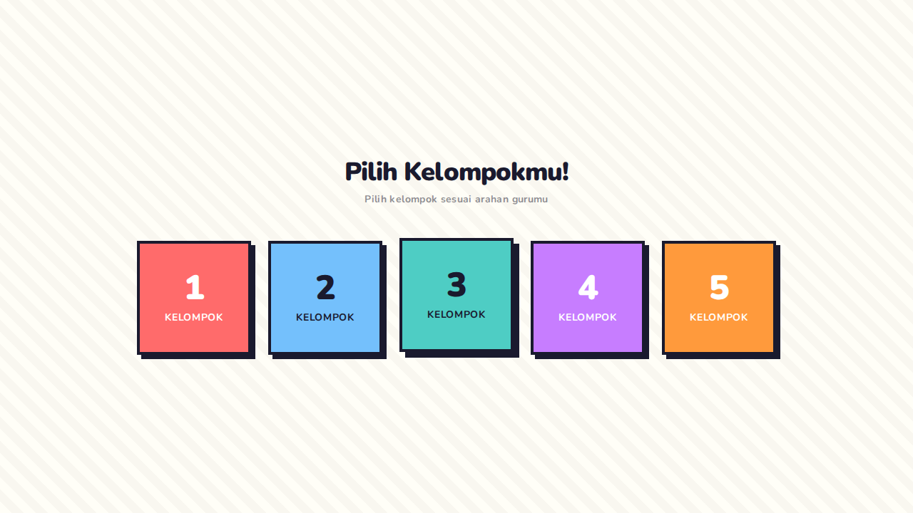
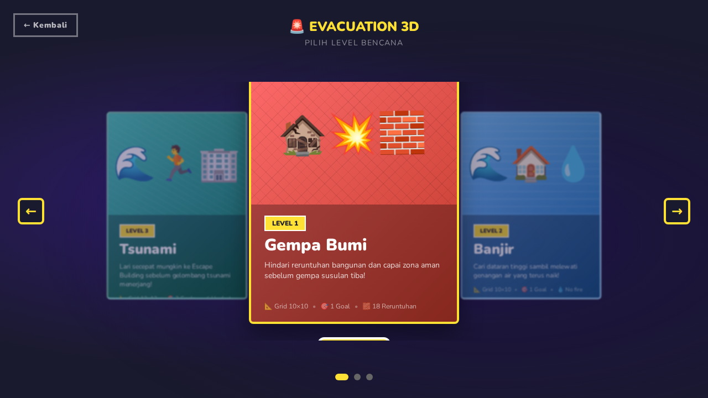
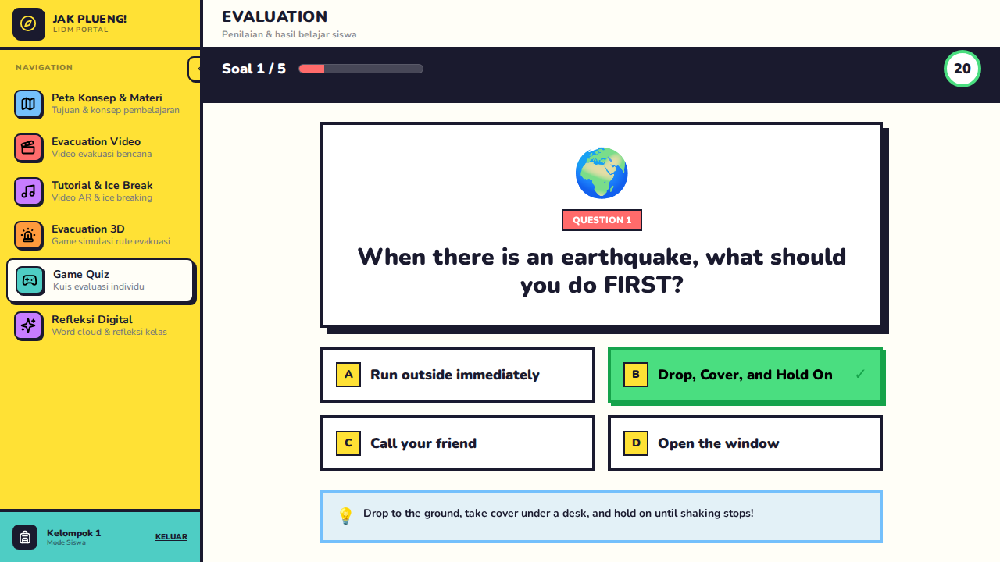

# JAK PLUENG! — Portal Microteaching Bahasa Inggris

**Live:** https://lidm-jakplueng.pages.dev · **Repo:** https://github.com/dezzorigin/lidm-jakplueng

Portal microteaching Bahasa Inggris untuk materi **Giving & Following
Instructions** dalam konteks bencana alam (gempa, banjir, tsunami) —
dibangun untuk **LIDM 2025**. Guru memandu sesi dari dashboard realtime;
siswa belajar lewat 6 langkah interaktif: peta konsep, spin wheel,
video evakuasi, tutorial + lagu ice-break, simulator 3D, kuis, dan
refleksi word cloud.






Video demo (2 menit, tur lengkap — klik thumbnail):

[](docs/demo/demo.mp4)

> Screenshot + video di atas adalah rekaman asli aplikasi dari CI
> Playwright (desktop 1280×720). Kartu preview link (og-image) bukan
> screenshot — itu kartu grafis di `public/og-image.png`.

## Cara main (siswa, tanpa akun)

1. Buka situs → **Masuk sebagai Siswa** (splash 4,5 detik, bisa ketuk
   untuk skip).
2. **Pilih Kelompokmu** (1–5).
3. Ikuti 6 langkah: Peta Konsep → Spin Wheel (guru) → Evacuation Video
   → Tutorial & Ice Break → Evacuation 3D → Game Quiz → Refleksi.
4. Kuis: 5 soal Bahasa Inggris, 20 detik per soal; hasil langsung
   tampil dan (kalau backend tersambung) masuk papan skor guru.

## Mode guru

Login di `/admin/login` (akun Supabase) → **Dashboard Guru**
(`/dashboard-guru`): sesi aktif, kelompok, siswa online, progres
simulator live, skor kuis, dan word cloud refleksi — semua realtime.
Spin wheel membagi kelompok dan menyimpannya ke Supabase; hasil bisa
diekspor (docx/pdf).

## Tanpa backend (mode demo)

Tanpa `VITE_SUPABASE_URL` / `VITE_SUPABASE_ANON_KEY`, aplikasi tetap
jalan: modul siswa berfungsi penuh secara lokal (kelompok 1–5, kuis,
word cloud), hanya fitur guru/realtime yang tidak aktif. Lihat
[docs/ARCHITECTURE.md](docs/ARCHITECTURE.md) bagian "Tanpa backend".

## Tech stack

- **Vite 5 + React 18 + TypeScript (strict)** + Tailwind CSS 3
- React Router 6 · Zustand (simulator) · React Context (Auth, Curtain)
- React Three Fiber + Drei + Three.js (simulator evakuasi 3D)
- Framer Motion · Supabase (Auth, Postgres, Realtime) — opsional
- `docx` + `jspdf` untuk ekspor laporan

## Menjalankan lokal

```bash
npm ci
npm run dev        # http://localhost:5173
npm run build      # tsc && vite build -> dist/
npm run preview    # sajikan dist/ di 127.0.0.1:8580
```

Supabase (opsional — salin `.env.example` ke `.env`):

```bash
VITE_SUPABASE_URL=https://<proyek>.supabase.co
VITE_SUPABASE_ANON_KEY=<anon key proyek>
```

## Tes & CI

```bash
npm run typecheck   # tsc --noEmit
npm run validate    # gate anti-slop P0 + tag OG + favicon + SPA fallback
npm run smoke       # build + cek HTTP dist/ lokal
npx playwright test # HANYA di CI (desktop + Pixel 7)
```

CI (`.github/workflows/ci.yml`): build · static-checks · advisory-sweep
(OSV, produksi saja) · gitleaks (riwayat penuh) · playwright-e2e +
tur demo README · smoke. Detail: [docs/TESTING.md](docs/TESTING.md).

## Dokumentasi

- [docs/DESIGN.md](docs/DESIGN.md) — kontrak arah desain (neo-brutalist)
  + referensi + skor gate 7 sumbu
- [docs/ARCHITECTURE.md](docs/ARCHITECTURE.md) — rute, auth, tabel
  Supabase, mode demo, restructure
- [docs/TESTING.md](docs/TESTING.md) — cakupan tes + temuan audit
- [docs/DEPLOY.md](docs/DEPLOY.md) — Cloudflare Pages + verifikasi live
- [docs/diagrams.html](docs/diagrams.html) — diagram arsitektur & alur
- [PRD.md](PRD.md) — PRD produk · [CHANGELOG.md](CHANGELOG.md) — riwayat

## Lisensi

MIT — lihat [LICENSE](./LICENSE).

---
Dikembangkan oleh **dezzorigin** (Nabil Aulia Dika) untuk LIDM 2025.
